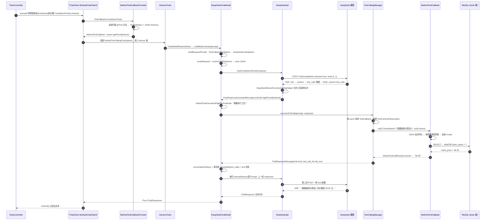

# Spring AI 工具调用原理：以 spring-ai-deepseek-demo 为例

> 分析对象：本工程 + Spring AI **1.1.8**（`pom.xml` 中 `spring-ai.version=1.1.8`）
> 核心结论：**Spring AI 不负责“决定”调用工具，它负责把 Java 方法描述成模型能看懂的 JSON Schema，并在模型返回 `tool_calls` 后，由 `ChatModel` 内部反射执行本地方法、拼接 `role=tool` 的消息，再自动发起下一轮请求。**

---

## 1. 本工程里与工具调用有关的代码

只有两处是关键：

```java
// ToolsController.java
return chatClient.prompt(prompt)
        .tools(bookTools)          // ① 把对象交给 Spring AI 扫描
        .advisors(new SimpleLoggerAdvisor())
        .stream()
        .content();                // ② 流式返回最终自然语言答案
```

```java
// BookTools.java
@Service
public class BookTools {

    @Autowired
    private BookMapper bookMapper;

    @Tool(description = "根据书名查询书籍价格")   // ③ 唯一被注册的工具
    public BigDecimal getPriceByName(String bookName) {
        QueryWrapper<Book> queryWrapper = new QueryWrapper<Book>().eq("book_name", bookName);
        return bookMapper.selectOne(queryWrapper).getBookPrice();
    }
}
```

`BookService` 里也有一个一模一样的 `@Tool` 方法，但它**没有被任何 `ChatClient` 注册**，因此不参与本次调用（见第 10 节）。

---

## 2. 端到端时序图



关键点：**图中只有一次 `chatClient.stream()` 调用，但底层发生了两次（或更多）HTTP 请求。工具执行循环藏在 `DeepSeekChatModel` 内部。**

---

## 3. 阶段一：`.tools(bookTools)` 把 Java 对象变成工具描述

### 3.1 ChatClient 的入口

`DefaultChatClient.DefaultChatClientRequestSpec#tools`：

```java
@Override
public ChatClientRequestSpec tools(Object... toolObjects) {
    Assert.notNull(toolObjects, "toolObjects cannot be null");
    Assert.noNullElements(toolObjects, "toolObjects cannot contain null elements");
    this.toolCallbacks.addAll(Arrays.asList(ToolCallbacks.from(toolObjects)));
    return this;
}
```

注意：**这里就已经完成扫描**，不是在发请求时。`ToolCallbacks.from` 只是薄封装：

```java
// org.springframework.ai.support.ToolCallbacks
public static ToolCallback[] from(Object... sources) {
    return MethodToolCallbackProvider.builder().toolObjects(sources).build().getToolCallbacks();
}
```

### 3.2 扫描 `@Tool` 方法

`MethodToolCallbackProvider` 构造时先校验“至少有一个 `@Tool` 方法”，否则直接抛异常（提示你改用 `.toolCallbacks()`）：

```java
// MethodToolCallbackProvider#assertToolAnnotatedMethodsPresent
List<Method> toolMethods = Stream
    .of(ReflectionUtils.getDeclaredMethods(
            AopUtils.isAopProxy(toolObject) ? AopUtils.getTargetClass(toolObject) : toolObject.getClass()))
    .filter(this::isToolAnnotatedMethod)
    .filter(toolMethod -> !isFunctionalType(toolMethod))
    .toList();

if (toolMethods.isEmpty()) {
    throw new IllegalStateException("No @Tool annotated methods found in " + toolObject + "." ...);
}
```

真正的构建在 `getToolCallbacks()`：

```java
.map(toolMethod -> MethodToolCallback.builder()
    .toolDefinition(ToolDefinitions.from(toolMethod))          // 名字/描述/JSON Schema
    .toolMetadata(ToolMetadata.from(toolMethod))               // returnDirect
    .toolMethod(toolMethod)
    .toolObject(toolObject)                                    // 这里是 BookTools 实例
    .toolCallResultConverter(ToolUtils.getToolCallResultConverter(toolMethod))
    .build())
```

对本工程来说，扫描结果是**一个** `MethodToolCallback`：

| 属性 | 值 | 来源 |
|---|---|---|
| tool name | `getPriceByName` | `@Tool.name()` 为空 → 方法名 |
| description | `根据书名查询书籍价格` | `@Tool.description()` |
| input schema | 见下 | `JsonSchemaGenerator` |
| target object | `BookTools` Bean | `.tools(bookTools)` |
| returnDirect | `false` | `@Tool.returnDirect()` 默认值 |

### 3.3 JSON Schema 是怎么生成的

`ToolDefinitions.from(method)` 组装：

```java
DefaultToolDefinition.builder()
    .name(ToolUtils.getToolName(method))
    .description(ToolUtils.getToolDescription(method))
    .inputSchema(JsonSchemaGenerator.generateForMethodInput(method));
```

`JsonSchemaGenerator`（基于 victools jsonschema-generator）对方法参数逐个生成属性：

```java
// JsonSchemaGenerator#generateForMethodInput（节选）
schema.put("$schema", SchemaVersion.DRAFT_2020_12.getIdentifier());
schema.put("type", "object");

for (int i = 0; i < method.getParameterCount(); i++) {
    String parameterName = method.getParameters()[i].getName();
    Type parameterType = method.getGenericParameterTypes()[i];

    // ToolContext 参数不进入 Schema，它在执行时由框架注入
    if (parameterType instanceof Class<?> parameterClass
            && ClassUtils.isAssignable(ToolContext.class, parameterClass)) {
        continue;
    }
    if (isMethodParameterRequired(method, i)) {
        required.add(parameterName);
    }
    ObjectNode parameterNode = SUBTYPE_SCHEMA_GENERATOR.generateSchema(parameterType);
    parameterNode.remove("format");
    ...
    properties.set(parameterName, parameterNode);
}

var requiredArray = schema.putArray("required");
required.forEach(requiredArray::add);

// 无参调用时，内部会补充 additionalProperties=false
processSchemaOptions(schemaOptions, schema);
```

本工程 `getPriceByName(String bookName)` 生成的 Schema 大致是：

```json
{
  "$schema": "https://json-schema.org/draft/2020-12/schema",
  "type": "object",
  "properties": {
    "bookName": { "type": "string" }
  },
  "required": ["bookName"],
  "additionalProperties": false
}
```

这里有四个容易踩的点：

1. **参数名依赖 `-parameters` 编译开关**。如果没有该开关，反射拿到的是 `arg0`，模型就必须生成 `{"arg0": ...}`。Spring Boot 3.4.4 的 `spring-boot-starter-parent` 在 `pluginManagement` 中为 `maven-compiler-plugin` 配置了 `<parameters>true</parameters>`；本工程 `target/classes/.../BookTools.class` 的 `MethodParameters` 中也确实是 `bookName`，所以没问题。
2. **默认所有参数都是 required**。`JsonSchemaGenerator.PROPERTY_REQUIRED_BY_DEFAULT = true`。要可选，用 `@ToolParam(required = false)` 或 `@Nullable`。
3. **`additionalProperties=false`** 默认会写入，约束模型不要乱造字段。
4. 参数没有 `@ToolParam(description=...)` 时，Schema 里就没有该字段的 `description`，模型只能靠参数名和工具描述理解语义。

> 当前 `@Tool` 方法名 `getPriceByName` 只包含字母，符合推荐命名规则（字母/数字/下划线/连字符/点）。若方法名含空格等字符，`ToolUtils.validateToolName` 会告警。

---

## 4. 阶段二：从 ChatClient 请求到 ChatOptions

`.stream()` 先构建 Advisor 链，再把请求交给模型：

```java
// DefaultChatClient.DefaultChatClientRequestSpec
public StreamResponseSpec stream() {
    BaseAdvisorChain advisorChain = buildAdvisorChain();
    return new DefaultStreamResponseSpec(DefaultChatClientUtils.toChatClientRequest(this), advisorChain,
            this.observationRegistry, this.chatClientObservationConvention);
}

private BaseAdvisorChain buildAdvisorChain() {
    // 模型调用 Advisor 永远在链底
    this.advisors.add(ChatModelCallAdvisor.builder().chatModel(this.chatModel).build());
    this.advisors.add(ChatModelStreamAdvisor.builder().chatModel(this.chatModel).build());
    return DefaultAroundAdvisorChain.builder(this.observationRegistry)
        .observationConvention(this.advisorObservationConvention)
        .pushAll(this.advisors)
        .build();
}
```

`toChatClientRequest` 里关键的 Options 组装：

```java
// DefaultChatClientUtils#toChatClientRequest（节选）
ChatOptions processedChatOptions = inputRequest.getChatOptions();

// 有工具相关配置但没有 ChatOptions → 创建 ToolCallingChatOptions
if (!inputRequest.getToolNames().isEmpty() || !inputRequest.getToolCallbacks().isEmpty()
        || !inputRequest.getToolCallbackProviders().isEmpty()
        || !CollectionUtils.isEmpty(inputRequest.getToolContext())) {
    if (processedChatOptions == null) {
        processedChatOptions = new DefaultToolCallingChatOptions();
    }
    else if (processedChatOptions instanceof DefaultChatOptions defaultChatOptions) {
        processedChatOptions = ModelOptionsUtils.copyToTarget(defaultChatOptions, ChatOptions.class,
                DefaultToolCallingChatOptions.class);
    }
}

if (processedChatOptions instanceof ToolCallingChatOptions toolCallingChatOptions) {
    // 合并 toolNames / toolCallbacks / toolContext
    List<ToolCallback> allToolCallbacks = new ArrayList<>(inputRequest.getToolCallbacks());
    for (var provider : inputRequest.getToolCallbackProviders()) {
        allToolCallbacks.addAll(List.of(provider.getToolCallbacks()));
    }
    if (!allToolCallbacks.isEmpty()) {
        List<ToolCallback> toolCallbacks = ToolCallingChatOptions.mergeToolCallbacks(
                allToolCallbacks, toolCallingChatOptions.getToolCallbacks());
        ToolCallingChatOptions.validateToolCallbacks(toolCallbacks);  // 重复工具名直接报错
        toolCallingChatOptions.setToolCallbacks(toolCallbacks);
    }
    ...
}
```

随后 `ChatModelStreamAdvisor` 只做一件事：调用模型并把响应包成 `ChatClientResponse`：

```java
return this.chatModel.stream(chatClientRequest.prompt())
    .map(chatResponse -> ChatClientResponse.builder()
        .chatResponse(chatResponse)
        .context(Map.copyOf(chatClientRequest.context()))
        .build())
    .publishOn(Schedulers.boundedElastic());
```

**因此：`SimpleLoggerAdvisor` 这类 Advisor 看到的只是“一次逻辑调用 + 最终聚合响应”，看不到工具调用的中间轮次。** 工具循环完全在 `ChatModel` 内部。

---

## 5. 阶段三：DeepSeekChatModel 把工具定义放进请求

### 5.1 选项转换：ToolCallingChatOptions → DeepSeekChatOptions

```java
// DeepSeekChatModel#buildRequestPrompt
if (prompt.getOptions() instanceof ToolCallingChatOptions toolCallingChatOptions) {
    runtimeOptions = ModelOptionsUtils.copyToTarget(toolCallingChatOptions, ToolCallingChatOptions.class,
            DeepSeekChatOptions.class);
}
...
DeepSeekChatOptions requestOptions = ModelOptionsUtils.merge(runtimeOptions, this.defaultOptions,
        DeepSeekChatOptions.class);

requestOptions.setInternalToolExecutionEnabled(
        ModelOptionsUtils.mergeOption(runtimeOptions.getInternalToolExecutionEnabled(),
                this.defaultOptions.getInternalToolExecutionEnabled()));
requestOptions.setToolNames(ToolCallingChatOptions.mergeToolNames(
        runtimeOptions.getToolNames(), this.defaultOptions.getToolNames()));
requestOptions.setToolCallbacks(ToolCallingChatOptions.mergeToolCallbacks(
        runtimeOptions.getToolCallbacks(), this.defaultOptions.getToolCallbacks()));
requestOptions.setToolContext(ToolCallingChatOptions.mergeToolContext(
        runtimeOptions.getToolContext(), this.defaultOptions.getToolContext()));

ToolCallingChatOptions.validateToolCallbacks(requestOptions.getToolCallbacks());
```

这里 `runtimeOptions`（本次请求）优先于 `defaultOptions`（Builder 默认配置）。`internalToolExecutionEnabled` 默认为 **true**：

```java
// ToolCallingChatOptions
boolean DEFAULT_TOOL_EXECUTION_ENABLED = true;

static boolean isInternalToolExecutionEnabled(ChatOptions chatOptions) {
    if (chatOptions instanceof ToolCallingChatOptions toolCallingChatOptions
            && toolCallingChatOptions.getInternalToolExecutionEnabled() != null) {
        return Boolean.TRUE.equals(toolCallingChatOptions.getInternalToolExecutionEnabled());
    }
    return DEFAULT_TOOL_EXECUTION_ENABLED;
}
```

### 5.2 消息与工具的序列化

`createRequest` 把 Spring AI 的 `Message` 映射成 DeepSeek/OpenAI 兼容格式：

```java
// DeepSeekChatModel#createRequest（节选）
if (message.getMessageType() == MessageType.ASSISTANT) {
    var assistantMessage = (AssistantMessage) message;
    List<ToolCall> toolCalls = null;
    if (!CollectionUtils.isEmpty(assistantMessage.getToolCalls())) {
        toolCalls = assistantMessage.getToolCalls().stream().map(toolCall -> {
            var function = new ChatCompletionFunction(toolCall.name(), toolCall.arguments());
            return new ToolCall(toolCall.id(), toolCall.type(), function);
        }).toList();
    }
    return List.of(new ChatCompletionMessage(assistantMessage.getText(),
            ChatCompletionMessage.Role.ASSISTANT, null, null, toolCalls, isPrefixAssistantMessage, null));
}
else if (message.getMessageType() == MessageType.TOOL) {
    ToolResponseMessage toolMessage = (ToolResponseMessage) message;
    toolMessage.getResponses()
        .forEach(response -> Assert.isTrue(response.id() != null, "ToolResponseMessage must have an id"));
    return toolMessage.getResponses().stream()
        .map(tr -> new ChatCompletionMessage(tr.responseData(), ChatCompletionMessage.Role.TOOL, tr.name(),
                tr.id(), null))
        .toList();
}
```

再解析工具定义并挂到请求上：

```java
// 每轮请求都会重新解析
List<ToolDefinition> toolDefinitions = this.toolCallingManager.resolveToolDefinitions(requestOptions);
if (!CollectionUtils.isEmpty(toolDefinitions)) {
    request = ModelOptionsUtils.merge(
            DeepSeekChatOptions.builder().tools(this.getFunctionTools(toolDefinitions)).build(),
            request, ChatCompletionRequest.class);
}

private List<DeepSeekApi.FunctionTool> getFunctionTools(List<ToolDefinition> toolDefinitions) {
    return toolDefinitions.stream().map(toolDefinition -> {
        var function = new DeepSeekApi.FunctionTool.Function(
                toolDefinition.description(), toolDefinition.name(), toolDefinition.inputSchema());
        return new DeepSeekApi.FunctionTool(function);
    }).toList();
}
```

`Function(String description, String name, String jsonSchema)` 构造器内部把 Schema 字符串转成 `Map`：

```java
public Function(String description, String name, String jsonSchema) {
    this(description, name, ModelOptionsUtils.jsonToMap(jsonSchema), null);
}
```

### 5.3 第一轮实际发出的请求（近似）

```json
POST https://api.deepseek.com/chat/completions
{
  "model": "deepseek-flash",
  "messages": [
    { "role": "user", "content": "请帮我查询数据结构与算法的价格" }
  ],
  "tools": [
    {
      "type": "function",
      "function": {
        "name": "getPriceByName",
        "description": "根据书名查询书籍价格",
        "parameters": {
          "$schema": "https://json-schema.org/draft/2020-12/schema",
          "type": "object",
          "properties": { "bookName": { "type": "string" } },
          "required": ["bookName"],
          "additionalProperties": false
        }
      }
    }
  ],
  "stream": true
}
```

工具名和描述来自 Java 注解，`parameters` 来自反射 + JSON Schema 生成器。**这一步没有任何本地方法被调用；只是把“能力清单”告诉模型。** 至于模型是否调用、调用哪个工具，完全由模型根据 `name` / `description` / `parameters` 自行决定；本工程没有设置 `tool_choice`，由服务端按默认策略处理。

---

## 6. 阶段四：模型返回 `tool_calls`，流式响应如何合并

### 6.1 流式工具调用分片的合并（DeepSeek 实现的关键）

OpenAI 兼容的流式协议里，`tool_calls` 的 `name` 和 `arguments` 可能被拆到多个 SSE chunk 中。如果直接把第一个带 `tool_calls` 的 chunk 拿去执行，参数就是不完整的。

`DeepSeekApi#chatCompletionStream` 用 `windowUntil` 把同一次工具调用的所有分片聚成一个窗口，再 `reduce` 合并：

```java
AtomicBoolean isInsideTool = new AtomicBoolean(false);

return this.webClient.post()
    .uri(this.getEndpoint(chatRequest))
    .headers(headers -> headers.addAll(additionalHttpHeader))
    .body(Mono.just(chatRequest), ChatCompletionRequest.class)
    .retrieve()
    .bodyToFlux(String.class)
    .takeUntil(SSE_DONE_PREDICATE)
    .filter(SSE_DONE_PREDICATE.negate())
    .map(content -> ModelOptionsUtils.jsonToObject(content, ChatCompletionChunk.class))
    .map(chunk -> {
        if (this.chunkMerger.isStreamingToolFunctionCall(chunk)) {
            isInsideTool.set(true);
        }
        return chunk;
    })
    // 把同一次 function call 的 chunk 归到一个 window
    .windowUntil(chunk -> {
        if (isInsideTool.get() && this.chunkMerger.isStreamingToolFunctionCallFinish(chunk)) {
            isInsideTool.set(false);
            return true;
        }
        return !isInsideTool.get();
    })
    .concatMapIterable(window -> {
        Mono<ChatCompletionChunk> monoChunk = window.reduce(
                new ChatCompletionChunk(null, null, null, null, null, null, null, null),
                (previous, current) -> this.chunkMerger.merge(previous, current));
        return List.of(monoChunk);
    })
    .flatMap(mono -> mono);
```

`DeepSeekStreamFunctionCallingHelper#merge` 对 `arguments` 做字符串拼接：

```java
private ChatCompletionFunction merge(ChatCompletionFunction previous, ChatCompletionFunction current) {
    if (previous == null) {
        return current;
    }
    String name = (StringUtils.hasText(current.name()) ? current.name() : previous.name());
    StringBuilder arguments = new StringBuilder();
    if (previous.arguments() != null) {
        arguments.append(previous.arguments());
    }
    if (current.arguments() != null) {
        arguments.append(current.arguments());
    }
    return new ChatCompletionFunction(name, arguments.toString());
}
```

`isStreamingToolFunctionCallFinish` 用 `finishReason == TOOL_CALLS` 判断窗口结束（`DeepSeekApi.ChatCompletionFinishReason.TOOL_CALLS` 映射 JSON 的 `tool_calls`）。

> ⚠️ 该 helper 里有一个限制：`if (current.toolCalls().size() > 1) throw new IllegalStateException("Currently only one tool call is supported per message!")`。即 **DeepSeek 流式模式下单条消息只支持一个工具调用**。本工程一次只查一本书，正好符合。

### 6.2 转成 Spring AI 的 ChatResponse

`buildGeneration` 把 DeepSeek 的 `ToolCall` 映射为 `AssistantMessage.ToolCall(id, "function", name, arguments)`：

```java
List<AssistantMessage.ToolCall> toolCalls = choice.message().toolCalls() == null ? List.of()
        : choice.message().toolCalls().stream()
            .map(toolCall -> new AssistantMessage.ToolCall(toolCall.id(), "function",
                    toolCall.function().name(), toolCall.function().arguments()))
            .toList();
```

`ChatResponse.hasToolCalls()` 判断任意 generation 的 output 带工具调用：

```java
public boolean hasToolCalls() {
    if (CollectionUtils.isEmpty(this.generations)) {
        return false;
    }
    return this.generations.stream().anyMatch(generation -> generation.getOutput().hasToolCalls());
}
```

模型返回的工具调用（近似）：

```json
{
  "id": "chatcmpl-xxx",
  "choices": [{
    "index": 0,
    "finish_reason": "tool_calls",
    "message": {
      "role": "assistant",
      "tool_calls": [{
        "id": "call_0",
        "type": "function",
        "function": {
          "name": "getPriceByName",
          "arguments": "{\"bookName\":\"数据结构与算法\"}"
        }
      }]
    }
  }]
}
```

> `ChatCompletionMessage` 标注了 `@JsonInclude(Include.NON_NULL)`，所以 `content` 为 null 时 JSON 里会直接省略该字段，而不是出现 `"content": null`。

---

## 7. 阶段五：谁来判断“要执行工具”，以及怎么执行

### 7.1 判断条件

```java
// DefaultToolExecutionEligibilityPredicate
@Override
public boolean test(ChatOptions promptOptions, ChatResponse chatResponse) {
    return ToolCallingChatOptions.isInternalToolExecutionEnabled(promptOptions) && chatResponse != null
            && chatResponse.hasToolCalls();
}
```

两个条件同时满足：

1. `internalToolExecutionEnabled != false`（默认 true）；
2. 响应里确实有 `tool_calls`。

`DeepSeekChatModel#internalStream` 在**每个 chunk 的 ChatResponse** 上判断：

```java
Flux<ChatResponse> flux = chatResponse.flatMap(response -> {
    if (this.toolExecutionEligibilityPredicate.isToolExecutionRequired(prompt.getOptions(), response)) {
        return Flux.deferContextual(ctx -> {
            ToolExecutionResult toolExecutionResult;
            try {
                ToolCallReactiveContextHolder.setContext(ctx);
                toolExecutionResult = this.toolCallingManager.executeToolCalls(prompt, response);
            }
            finally {
                ToolCallReactiveContextHolder.clearContext();
            }
            if (toolExecutionResult.returnDirect()) {
                return Flux.just(ChatResponse.builder().from(response)
                        .generations(ToolExecutionResult.buildGenerations(toolExecutionResult))
                        .build());
            }
            return this.internalStream(
                    new Prompt(toolExecutionResult.conversationHistory(), prompt.getOptions()), response);
        }).subscribeOn(Schedulers.boundedElastic());
    }
    return Flux.just(response);
})
```

几个细节：

- 工具执行是**阻塞**的（JDBC），因此放在 `Schedulers.boundedElastic()` 上，避免阻塞 Reactor 的 NIO 线程。
- `ToolCallReactiveContextHolder` 把 Reactor 的 `Context` 暴露给同步执行的工具，让工具在非 Reactor 线程里也能读到上下文（例如多租户、观测信息）。
- 非流式路径 `internalCall` 是同样的逻辑，只是用普通递归：

```java
if (this.toolExecutionEligibilityPredicate.isToolExecutionRequired(prompt.getOptions(), response)) {
    var toolExecutionResult = this.toolCallingManager.executeToolCalls(prompt, response);
    if (toolExecutionResult.returnDirect()) {
        return ChatResponse.builder().from(response)
                .generations(ToolExecutionResult.buildGenerations(toolExecutionResult))
                .build();
    }
    return this.internalCall(
            new Prompt(toolExecutionResult.conversationHistory(), prompt.getOptions()), response);
}
```

### 7.2 ToolCallingManager：执行工具并生成 `role=tool` 消息

`DefaultToolCallingManager#executeToolCalls`：

```java
Optional<Generation> toolCallGeneration = chatResponse.getResults()
    .stream()
    .filter(g -> !CollectionUtils.isEmpty(g.getOutput().getToolCalls()))
    .findFirst();

if (toolCallGeneration.isEmpty()) {
    throw new IllegalStateException("No tool call requested by the chat model");
}

AssistantMessage assistantMessage = toolCallGeneration.get().getOutput();
ToolContext toolContext = buildToolContext(prompt, assistantMessage);
InternalToolExecutionResult internalToolExecutionResult = executeToolCall(prompt, assistantMessage, toolContext);
List<Message> conversationHistory = buildConversationHistoryAfterToolExecution(
        prompt.getInstructions(), assistantMessage, internalToolExecutionResult.toolResponseMessage());

return ToolExecutionResult.builder()
    .conversationHistory(conversationHistory)
    .returnDirect(internalToolExecutionResult.returnDirect())
    .build();
```

核心循环 `executeToolCall`：

```java
for (AssistantMessage.ToolCall toolCall : assistantMessage.getToolCalls()) {
    logger.debug("Executing tool call: {}", toolCall.name());

    String toolName = toolCall.name();
    String toolInputArguments = toolCall.arguments();

    // 流式模式下参数可能为空的兜底
    final String finalToolInputArguments;
    if (!StringUtils.hasText(toolInputArguments)) {
        logger.warn("Tool call arguments are null or empty for tool: {}. Using empty JSON object as default.", toolName);
        finalToolInputArguments = "{}";
    }
    else {
        finalToolInputArguments = toolInputArguments;
    }

    // 优先用本次请求 options 里的 callback，其次用全局 resolver
    ToolCallback toolCallback = toolCallbacks.stream()
        .filter(tool -> toolName.equals(tool.getToolDefinition().name()))
        .findFirst()
        .orElseGet(() -> this.toolCallbackResolver.resolve(toolName));

    if (toolCallback == null) {
        throw new IllegalStateException("No ToolCallback found for tool name: " + toolName);
    }

    // returnDirect 多工具时取“与”
    if (returnDirect == null) {
        returnDirect = toolCallback.getToolMetadata().returnDirect();
    }
    else {
        returnDirect = returnDirect && toolCallback.getToolMetadata().returnDirect();
    }

    // Micrometer Observation，可在观测/日志里看到工具名、参数、结果
    String toolCallResult = ToolCallingObservationDocumentation.TOOL_CALL
        .observation(...)
        .observe(() -> {
            String toolResult;
            try {
                toolResult = toolCallback.call(finalToolInputArguments, toolContext);
            }
            catch (ToolExecutionException ex) {
                toolResult = this.toolExecutionExceptionProcessor.process(ex);
            }
            observationContext.setToolCallResult(toolResult);
            return toolResult;
        });

    toolResponses.add(new ToolResponseMessage.ToolResponse(
            toolCall.id(), toolName, toolCallResult != null ? toolCallResult : ""));
}
```

会话历史拼接：

```java
private List<Message> buildConversationHistoryAfterToolExecution(
        List<Message> previousMessages, AssistantMessage assistantMessage,
        ToolResponseMessage toolResponseMessage) {
    List<Message> messages = new ArrayList<>(previousMessages);
    messages.add(assistantMessage);         // assistant(tool_calls)
    messages.add(toolResponseMessage);      // tool 结果
    return messages;
}
```

### 7.3 MethodToolCallback：JSON 参数 → Java 参数 → 反射调用

```java
@Override
public String call(String toolInput, @Nullable ToolContext toolContext) {
    Assert.hasText(toolInput, "toolInput cannot be null or empty");

    this.validateToolContextSupport(toolContext);              // 方法要求 ToolContext 时必须提供

    Map<String, Object> toolArguments = this.extractToolArguments(toolInput); // JSON → Map
    Object[] methodArguments = this.buildMethodArguments(toolArguments, toolContext);

    Object result = this.callMethod(methodArguments);          // method.invoke(toolObject, args)

    Type returnType = this.toolMethod.getGenericReturnType();
    return this.toolCallResultConverter.convert(result, returnType);
}
```

参数映射按**编译期参数名**从 JSON 里取值，并做类型转换：

```java
private Object[] buildMethodArguments(Map<String, Object> toolInputArguments, @Nullable ToolContext toolContext) {
    return Stream.of(this.toolMethod.getParameters()).map(parameter -> {
        if (parameter.getType().isAssignableFrom(ToolContext.class)) {
            return toolContext;                                // 框架注入，不来自模型
        }
        Object rawArgument = toolInputArguments.get(parameter.getName());
        return buildTypedArgument(rawArgument, parameter.getParameterizedType());
    }).toArray();
}
```

反射调用与异常包装：

```java
private Object callMethod(Object[] methodArguments) {
    if (isObjectNotPublic() || isMethodNotPublic()) {
        this.toolMethod.setAccessible(true);
    }
    try {
        return this.toolMethod.invoke(this.toolObject, methodArguments);
    }
    catch (InvocationTargetException ex) {
        throw new ToolExecutionException(this.toolDefinition, ex.getCause());
    }
}
```

返回值默认转成 JSON 字符串：

```java
// DefaultToolCallResultConverter#convert
if (returnType == Void.TYPE) {
    return JsonParser.toJson("Done");
}
if (result instanceof RenderedImage) {
    // 图片 → base64 {"mimeType":"image/png","data":"..."}
}
return JsonParser.toJson(result);
```

所以 `BigDecimal 36.55` 变成字符串 `"36.55"`（JSON 数字文本）。工具结果进入 `ToolResponseMessage.ToolResponse(id, name, "36.55")`。

### 7.4 异常处理：默认把错误文本喂给模型，而不是抛给前端

```java
// DefaultToolExecutionExceptionProcessor#process
Throwable cause = exception.getCause();
if (cause instanceof RuntimeException runtimeException) {
    if (this.rethrownExceptions.stream().anyMatch(rethrown -> rethrown.isAssignableFrom(cause.getClass()))) {
        throw runtimeException;
    }
}
else {
    throw exception;   // 非 RuntimeException，直接抛出
}
if (this.alwaysThrow) {
    throw exception;
}
String message = exception.getMessage();
if (message == null || message.isBlank()) {
    message = "Exception occurred in tool: " + exception.getToolDefinition().name()
            + " (" + cause.getClass().getSimpleName() + ")";
}
return message;
```

**本工程的风险点**：`bookMapper.selectOne(queryWrapper).getBookPrice()` 在书名不存在时会 NPE。NPE 是 `RuntimeException`，默认 `alwaysThrow=false`，于是 NPE 的 message 会被当作工具结果发给模型，模型通常会回复“查询失败/未找到该书”。接口不会 500，但给模型的文本很不友好。更稳妥的写法是先判空并返回结构化错误，或抛出 `ToolExecutionException` 并配置更清晰的 message。

### 7.5 第二轮请求（近似）

```json
{
  "model": "deepseek-flash",
  "messages": [
    { "role": "user", "content": "请帮我查询数据结构与算法的价格" },
    {
      "role": "assistant",
      "tool_calls": [{
        "id": "call_0",
        "type": "function",
        "function": {
          "name": "getPriceByName",
          "arguments": "{\"bookName\":\"数据结构与算法\"}"
        }
      }]
    },
    {
      "role": "tool",
      "name": "getPriceByName",
      "tool_call_id": "call_0",
      "content": "36.55"
    }
  ],
  "tools": [ ... 同一份工具定义 ... ],
  "stream": true
}
```

模型看到 `role=tool` 的结果后生成自然语言答案。`internalStream` 递归时会把 `previousChatResponse` 传下去，`UsageCalculator` 把多轮 usage 累加，因此最终响应里的 token 统计包含两轮请求。

---

## 8. 完整调用链（按类名）

```
ToolsController#toolChat
└─ DefaultChatClient.DefaultChatClientRequestSpec#tools(Object...)
   └─ ToolCallbacks#from
      └─ MethodToolCallbackProvider#getToolCallbacks
         ├─ ReflectionUtils.getDeclaredMethods / AopUtils.getTargetClass
         ├─ ToolDefinitions#from
         │  └─ JsonSchemaGenerator#generateForMethodInput
         └─ new MethodToolCallback(definition, metadata, method, toolObject, converter)
└─ DefaultChatClient.DefaultChatClientRequestSpec#stream
   └─ DefaultChatClientUtils#toChatClientRequest
      └─ new DefaultToolCallingChatOptions + setToolCallbacks + validateToolCallbacks
   └─ DefaultAroundAdvisorChain#nextStream
      └─ SimpleLoggerAdvisor#adviseStream (聚合日志)
         └─ ChatModelStreamAdvisor#adviseStream
            └─ DeepSeekChatModel#stream
               ├─ buildRequestPrompt
               │  └─ copyToTarget(ToolCallingChatOptions → DeepSeekChatOptions)
               │  └─ merge(defaultOptions) + validateToolCallbacks
               └─ internalStream
                  ├─ createRequest
                  │  ├─ Message → ChatCompletionMessage（含 assistant.tool_calls / tool）
                  │  ├─ toolCallingManager.resolveToolDefinitions(requestOptions)
                  │  └─ getFunctionTools → request.tools
                  ├─ DeepSeekApi#chatCompletionStream
                  │  ├─ SSE → ChatCompletionChunk
                  │  └─ DeepSeekStreamFunctionCallingHelper 合并 tool_calls 分片
                  ├─ buildGeneration → AssistantMessage.toolCalls
                  ├─ DefaultToolExecutionEligibilityPredicate#test
                  └─ DefaultToolCallingManager#executeToolCalls
                     ├─ buildToolContext
                     ├─ executeToolCall
                     │  ├─ 按 name 找 ToolCallback
                     │  ├─ Observation
                     │  └─ MethodToolCallback#call
                     │     ├─ JsonParser.fromJson → Map
                     │     ├─ buildMethodArguments（按参数名 + 类型）
                     │     ├─ method.invoke(toolObject, args)
                     │     └─ DefaultToolCallResultConverter → JSON 字符串
                     ├─ ToolResponseMessage
                     └─ buildConversationHistoryAfterToolExecution
                  └─ 递归 internalStream（第二轮 HTTP）
```

---

## 9. 自动配置如何把组件装配起来

- `ChatClientAutoConfiguration` 提供 `prototype` 的 `ChatClient.Builder`，注入容器里的 `ChatModel`。
- `DeepSeekChatAutoConfiguration` 创建 `DeepSeekChatModel`，把容器里的 `ToolCallingManager` 注入进去：

```java
var chatModel = DeepSeekChatModel.builder()
    .deepSeekApi(deepSeekApi)
    .defaultOptions(chatProperties.getOptions())
    .toolCallingManager(toolCallingManager)
    .toolExecutionEligibilityPredicate(deepseekToolExecutionEligibilityPredicate
        .getIfUnique(DefaultToolExecutionEligibilityPredicate::new))
    .retryTemplate(retryTemplate)
    .observationRegistry(observationRegistry.getIfUnique(() -> ObservationRegistry.NOOP))
    .build();
```

- `ToolCallingAutoConfiguration` 创建 `ToolCallingManager` / `ToolCallbackResolver` / `ToolExecutionExceptionProcessor`，其中 resolver 会合并容器里的 `ToolCallback`、`ToolCallbackProvider` Bean，并支持按名字从 Spring Bean 中解析工具：

```java
@Bean
@ConditionalOnMissingBean
ToolCallingManager toolCallingManager(ToolCallbackResolver toolCallbackResolver,
        ToolExecutionExceptionProcessor toolExecutionExceptionProcessor,
        ObjectProvider<ObservationRegistry> observationRegistry,
        ObjectProvider<ToolCallingObservationConvention> observationConvention) {
    var toolCallingManager = ToolCallingManager.builder()
        .observationRegistry(observationRegistry.getIfUnique(() -> ObservationRegistry.NOOP))
        .toolCallbackResolver(toolCallbackResolver)
        ...
}
```

这也是为什么 `.tools()` 与 `.toolNames()` / MCP 工具能共用同一套执行器：**找 callback 的顺序是“请求级 callbacks 优先，全局 resolver 兜底”**。

---

## 10. 设计要点、容易误解的地方与改进建议

### 10.1 工具执行不在 ChatClient / Advisor 里

- `ChatClient` 只负责**收集工具、生成 Schema、放进 Options**。
- 真正的循环在 `ChatModel`（这里是 `DeepSeekChatModel`）。所以：
  - `SimpleLoggerAdvisor` 的 `adviseStream` 只打印一次请求和一次聚合后的最终响应；中间那轮 tool_calls 响应不会单独打印（但 `DefaultToolCallingManager` 的 debug 日志会打印 `Executing tool call: ...`）。
  - 如果你想自己接管工具执行（例如跨多个模型统一调度、前端显示工具过程），可以设置 `internalToolExecutionEnabled=false`，此时模型会把 `tool_calls` 原样返回，由调用方执行后再发起下一次请求。注意在这种模式下 `.content()` 通常拿不到内容（响应只有 `tool_calls`），需要改用 `.chatResponse()` 并自行读取 `AssistantMessage#getToolCalls()`。

### 10.2 流式工具调用依赖“分片合并”

`DeepSeekStreamFunctionCallingHelper` 是 DeepSeek 模块特有的适配器。如果没有它，Spring AI 可能在只拿到 `arguments` 的第一个片段时就执行工具。OpenAI 模块也有类似的 `OpenAiStreamFunctionCallingHelper`。这是“流式 + 工具调用”最容易出问题的点。

### 10.3 单条消息只支持一个工具调用（流式）

`DeepSeekStreamFunctionCallingHelper#merge` 明确抛异常：

```java
if (current.toolCalls().size() > 1) {
    throw new IllegalStateException("Currently only one tool call is supported per message!");
}
```

本工程只查一本书，没问题；如果以后模型一次要查多本书，**非流式**路径可以支持多个，**流式**路径会被上述限制打断。需要升级适配器或改成非流式。

### 10.4 参数名与 Schema 的编译期依赖

- `MethodToolCallback#buildMethodArguments` 用 `parameter.getName()` 取值；`JsonSchemaGenerator` 也用同一个名字生成 properties。
- 二者必须一致，且都依赖 `-parameters`。如果换 Maven 配置、Gradle 或手动 `javac` 时漏掉该参数，就会出现“Schema 里是 `bookName`，反射拿到 `arg0`，参数永远是 null”的隐蔽 bug。
- 建议关键工具参数显式加 `@ToolParam(description = "...")`，既补描述，也明确 required。

### 10.5 每次 `.tools()` 都会重新扫描

`ToolsController` 每次请求都执行：

```java
.tools(bookTools)
```

→ `ToolCallbacks.from` → `MethodToolCallbackProvider`。而且这里实际会扫描**两遍**：

- `MethodToolCallbackProvider` 构造器为了校验重复工具名，先调用了一次 `getToolCallbacks()`；
- `ToolCallbacks.from` 随后又调用一次 `getToolCallbacks()` 才返回结果。

所以本工程每个 `/toolChat` 请求都会做两轮“反射扫描 + JSON Schema 生成”。工具多、Schema 复杂时这是纯浪费。可以：

```java
// 构造器里构建一次
this.chatClient = chatClientBuilder
    .defaultTools(bookTools)        // 或 defaultToolCallbacks(ToolCallbacks.from(bookTools))
    .build();

// 请求时不再 .tools()
return chatClient.prompt(prompt).advisors(...).stream().content();
```

`DefaultChatClientBuilder#defaultTools` 只是把工具加到 `defaultRequest` 里：

```java
public Builder defaultTools(Object... toolObjects) {
    this.defaultRequest.tools(toolObjects);
    return this;
}
```

由于 Builder 是 `prototype` 作用域，每个注入点会拿到新实例，但 `build()` 之后的 `ChatClient` 会复用同一批 callback，不再每次请求重新扫描。

### 10.6 重复 `@Tool` 不会自动生效，但同名会报错

- `BookService` 的 `getPriceByName` 没有注册，就不会被模型看到；它只是“一个带注解的普通 Bean 方法”。
- 如果你同时 `.tools(bookTools, bookService)`，两个 callback 的 name 都是 `getPriceByName`，`ToolCallingChatOptions.validateToolCallbacks` 会抛：

```
Multiple tools with the same name (getPriceByName) found in ToolCallingChatOptions
```

### 10.7 ToolContext：不进入 Schema 的“侧信道”

- 方法参数类型是 `ToolContext` 时，Schema 生成阶段会跳过它；执行阶段由 `buildMethodArguments` 注入。
- 适合传用户 ID、租户、Trace ID 等模型不该看到/不该伪造的信息：

```java
.toolContext(Map.of("userId", currentUserId))
```

- 本工程没用到；如果工具里要鉴权，建议用 `ToolContext` 而不是让模型传 `userId`。

### 10.8 安全边界

- `MethodToolCallback#callMethod` 是**直接反射调用本地 Bean**，没有沙箱、没有超时、没有权限检查。模型生成的参数必须视为不可信输入。
- 本工程的 SQL 使用 MyBatis-Plus `QueryWrapper.eq("book_name", bookName)`，参数是占位符拼接，**没有 SQL 注入**；但如果换成字符串拼接 SQL、调用文件系统/命令/HTTP，就必须自己做校验、白名单、超时与限流。
- 工具描述和工具名也会进入模型上下文，不要在其中放密钥或敏感信息。

### 10.9 计费与上下文增长

- 每一轮工具调用都会重新发送**完整消息历史 + 完整工具 Schema**，token 消耗随轮次增加。
- 工具返回结果也进入上下文；大结果（如整页 HTML、长列表）会迅速撑大上下文。建议工具返回精简、结构化的数据。

### 10.10 `returnDirect` 分支

`@Tool(returnDirect = true)` 时，`ToolExecutionResult.returnDirect()` 为 true，`DeepSeekChatModel` 不再发起第二轮模型请求，而是直接把工具结果包装成 `ChatResponse` 返回：

```java
return ChatResponse.builder()
    .from(response)
    .generations(ToolExecutionResult.buildGenerations(toolExecutionResult))
    .build();
```

适合“工具结果就是最终答案”的场景（例如固定格式查询）。本工程未使用。

### 10.11 本工程配置层的一个小提醒

`application.yml` 中：

```yaml
spring.ai.deepseek.chat.options.model: deepseek-flash
```

模型名最终原样进入请求的 `model` 字段。请确认它与 DeepSeek 控制台当前可用的模型名一致（常见为 `deepseek-chat` / `deepseek-reasoner`；若 `deepseek-flash` 不被服务端接受，会直接返回 400，与工具调用逻辑无关）。

---

## 11. 如何自己打断点验证

按调用顺序设置断点（源码坐标基于 Spring AI 1.1.8）：

| 顺序 | 位置 | 预期现象 |
|---|---|---|
| 1 | `DefaultChatClient$DefaultChatClientRequestSpec#tools` | `toolObjects` 里有 `BookTools` |
| 2 | `MethodToolCallbackProvider#getToolCallbacks` | 生成 1 个 callback，name=`getPriceByName` |
| 3 | `JsonSchemaGenerator#generateForMethodInput` | 生成含 `bookName` 的 Schema |
| 4 | `DeepSeekChatModel#createRequest` | `request.tools` 非空 |
| 5 | `DeepSeekStreamFunctionCallingHelper#merge` | `arguments` 从 `""` 逐步拼成完整 JSON |
| 6 | `DefaultToolExecutionEligibilityPredicate#test` | 只有 finishReason=tool_calls 的那个响应返回 true |
| 7 | `DefaultToolCallingManager#executeToolCall` | `toolName=getPriceByName`，`finalToolInputArguments` 完整 |
| 8 | `MethodToolCallback#callMethod` | 反射进入 `BookTools#getPriceByName` |
| 9 | `DefaultToolCallResultConverter#convert` | 返回 `"36.55"` |
| 10 | `DeepSeekChatModel#internalStream`（递归处） | 第二次进入，prompt 里多了 assistant + tool 消息 |

日志上可以观察：

```yaml
logging:
  level:
    org.springframework.ai: debug
```

会看到类似：

```
Executing tool call: getPriceByName
Starting execution of tool: getPriceByName
Successful execution of tool: getPriceByName
```

以及 `SimpleLoggerAdvisor` 打印的 request/response（流式响应是在聚合后打印的）。

---

## 12. 参考源码（Spring AI 1.1.8，GitHub tag `v1.1.8`）

- ChatClient 请求组装：[DefaultChatClient.java](https://github.com/spring-projects/spring-ai/blob/v1.1.8/spring-ai-client-chat/src/main/java/org/springframework/ai/chat/client/DefaultChatClient.java#L920)、[DefaultChatClientUtils.java](https://github.com/spring-projects/spring-ai/blob/v1.1.8/spring-ai-client-chat/src/main/java/org/springframework/ai/chat/client/DefaultChatClientUtils.java#L111)
- 工具扫描与 Schema：[ToolCallbacks.java](https://github.com/spring-projects/spring-ai/blob/v1.1.8/spring-ai-model/src/main/java/org/springframework/ai/support/ToolCallbacks.java)、[MethodToolCallbackProvider.java](https://github.com/spring-projects/spring-ai/blob/v1.1.8/spring-ai-model/src/main/java/org/springframework/ai/tool/method/MethodToolCallbackProvider.java#L84)、[JsonSchemaGenerator.java](https://github.com/spring-projects/spring-ai/blob/v1.1.8/spring-ai-model/src/main/java/org/springframework/ai/util/json/schema/JsonSchemaGenerator.java#L120)
- 工具执行：[DefaultToolCallingManager.java](https://github.com/spring-projects/spring-ai/blob/v1.1.8/spring-ai-model/src/main/java/org/springframework/ai/model/tool/DefaultToolCallingManager.java#L126)、[MethodToolCallback.java](https://github.com/spring-projects/spring-ai/blob/v1.1.8/spring-ai-model/src/main/java/org/springframework/ai/tool/method/MethodToolCallback.java#L101)、[DefaultToolExecutionEligibilityPredicate.java](https://github.com/spring-projects/spring-ai/blob/v1.1.8/spring-ai-model/src/main/java/org/springframework/ai/model/tool/DefaultToolExecutionEligibilityPredicate.java#L32)
- DeepSeek 适配：[DeepSeekChatModel.java](https://github.com/spring-projects/spring-ai/blob/v1.1.8/models/spring-ai-deepseek/src/main/java/org/springframework/ai/deepseek/DeepSeekChatModel.java#L233)、[DeepSeekApi.java](https://github.com/spring-projects/spring-ai/blob/v1.1.8/models/spring-ai-deepseek/src/main/java/org/springframework/ai/deepseek/api/DeepSeekApi.java#L146)、[DeepSeekStreamFunctionCallingHelper.java](https://github.com/spring-projects/spring-ai/blob/v1.1.8/models/spring-ai-deepseek/src/main/java/org/springframework/ai/deepseek/api/DeepSeekStreamFunctionCallingHelper.java#L41)
- 自动配置：[ToolCallingAutoConfiguration.java](https://github.com/spring-projects/spring-ai/blob/v1.1.8/auto-configurations/models/tool/spring-ai-autoconfigure-model-tool/src/main/java/org/springframework/ai/model/tool/autoconfigure/ToolCallingAutoConfiguration.java#L134)、[DeepSeekChatAutoConfiguration.java](https://github.com/spring-projects/spring-ai/blob/v1.1.8/auto-configurations/models/spring-ai-autoconfigure-model-deepseek/src/main/java/org/springframework/ai/model/deepseek/autoconfigure/DeepSeekChatAutoConfiguration.java#L64)

---

## 13. 一句话总结

**工具调用的本质是“协议 + 反射 + 循环”**：

1. **协议**：把 `@Tool` 方法转成模型 API 的 `tools[].function`（name/description/JSON Schema）。
2. **反射**：模型返回 `tool_calls` 后，按工具名找到 `MethodToolCallback`，把 JSON 参数反序列化并按类型转换，`Method.invoke` 调用本地 Bean。
3. **循环**：把 `assistant(tool_calls)` 与 `role=tool` 的结果追加进消息历史，递归调用同一个 `ChatModel`，直到模型不再请求工具。

Spring AI 的价值在于把这三件事标准化、可观测、可扩展（`ToolCallbackResolver` / `ToolContext` / `returnDirect` / `internalToolExecutionEnabled` / MCP），而 DeepSeek 模块额外解决了**流式工具调用分片合并**这个协议适配问题。
